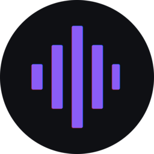

<p align="center">
  
</p>

<h1 align="center">Nuance</h1>

Nuance is a free, open-source desktop toolbox to customize and remix your MP3
files. Load a track, pick a preset or dial in your own effects, edit the tags
and cover, then export. Everything runs locally on your machine, with no
internet connection, no accounts and no file size limits.

It is built for the sound trends people actually make and share: Sped Up,
Nightcore, Slowed + Reverb, Chopped & Screwed, Phonk, Lo-Fi and Energy Boost.

## Features

- One-click presets: Sped Up, Nightcore, Slowed + Reverb, Chopped & Screwed,
  Phonk, Lo-Fi, Energy Boost.
- Manual controls for speed, pitch, bass boost, reverb and loop count.
- Optional "keep pitch" mode to change tempo without changing pitch.
- Muffled slider to roll off the high frequencies for a lo-fi, telephone tone.
- Bitcrush slider for a crunchy, retro console sound.
- Reverse the whole track.
- 8D auto-pan slider for the circling "8D audio" effect.
- Vinyl crackle and cassette hiss textures, each with its own intensity slider.
- Master section: loudness normalisation, punch (compression + limiter),
  brightness, stereo width and fade in/out - the "energy boosted" sound.
- Preview: render a short excerpt with the current settings and play it back,
  with a "find the drop" button that jumps to the track's loudest passage.
- Save your own presets: name the current settings and reload them any time.
- Metadata editor for title, artist, album and cover art (ID3 tags), including
  removing an existing cover.
- 100% local: no servers, no uploads, no ads.

## Requirements

- Python 3.10 or newer.
- FFmpeg (both `ffmpeg` and `ffprobe`) available on your system PATH.

### Installing FFmpeg

- Windows: download a build from https://www.gyan.dev/ffmpeg/builds/ and add
  its `bin` folder to your PATH, or run `winget install Gyan.FFmpeg`.
- macOS: `brew install ffmpeg`.
- Linux: install `ffmpeg` from your distribution's package manager.

To confirm it is set up, run `ffmpeg -version` and `ffprobe -version` in a
terminal. If both print version information, Nuance is ready.

## Install and run

```
pip install -r requirements.txt
python main.py
```

## Build a standalone executable

Nuance ships with an application icon at `nuance/ui/icon.ico`. To build a
single-file Windows executable, use a clean virtual environment so PyInstaller
only bundles what Nuance needs, then run the Flet packager:

```
python -m venv .buildenv
.buildenv\Scripts\activate
pip install -r requirements.txt pyinstaller
flet pack main.py --name Nuance --icon nuance/ui/icon.ico --add-data "nuance/ui/icon.ico:nuance/ui"
```

The single-file executable is written to the `dist` folder. Building inside a
dedicated virtual environment keeps the executable small; building from a
Python install that also has large unrelated packages will produce a much
bigger file.

FFmpeg is not bundled, so the machine running the app still needs `ffmpeg` and
`ffprobe` on its PATH.

## How to use

1. Click the load area and choose an MP3 file.
2. Pick a preset, or adjust the sliders and switches for a custom sound.
3. Optionally edit the title, artist, album and cover art.
4. Click "Export MP3" and choose where to save the result.

## Note

> Some errors encountered during software development were fixed with the help of Artificial Intelligence (AI).

## Presets at a glance

| Preset            | What it does                                        |
|-------------------|-----------------------------------------------------|
| Original          | No changes.                                         |
| Sped Up           | Faster tempo and higher pitch.                      |
| Nightcore         | Even faster with an extra pitch lift.               |
| Slowed + Reverb   | Slower tempo with a spacious reverb tail.           |
| Chopped & Screwed | Heavily slowed and pitched down.                    |
| Phonk             | Slightly slowed with a strong sub-bass boost.       |
| Lo-Fi             | Slightly slowed, soft reverb and vinyl texture.     |
| Energy Boost      | Slight speed-up, brighter, wider, compressed and loud. |

You can also save your own presets: dial in the settings you like, type a name
under the preset dropdown and click **Save**. They appear at the bottom of the
dropdown and can be removed with **Delete**. They are stored in a
`user_presets.json` file in your OS config folder (`%APPDATA%\Nuance` on
Windows, `~/.config/Nuance` elsewhere).

## Project layout

```
main.py                  Application entry point.
nuance/
  audio/
    ffmpeg.py            FFmpeg and ffprobe wrapper.
    effects.py           Presets and audio filter chains.
    textures.py          Synthesised background textures.
    highlights.py        Finds the track's loudest passage (the drop).
    userpresets.py       Load, save and delete the user's own presets.
    metadata.py          ID3 tag and cover art editor.
    processor.py         Ties effects and metadata into one export; previews.
  ui/
    app.py               The main window and all controls.
    theme.py             Colors and shared styling.
    icon.ico             Application and window icon.
tests/                   pytest suite for the audio core.
```

## Running the tests

```
pip install pytest
python -m pytest
```

Tests that need FFmpeg are skipped automatically when it is not on PATH.

## License

Nuance is released under the GNU General Public License v3.0. See the LICENSE
file for details.
